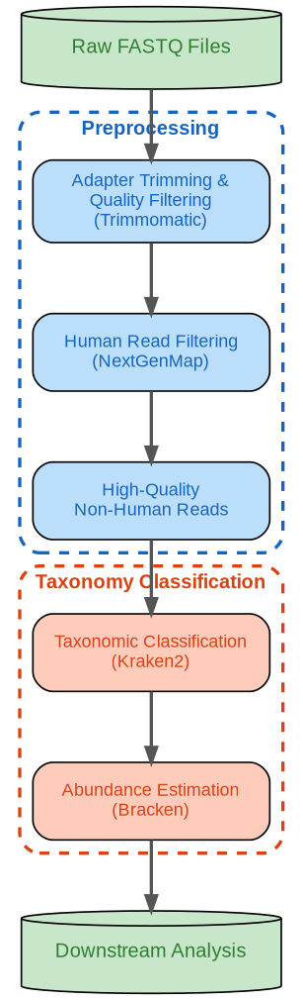

# Biopipe

Biopipe is a file-parallel, scalable Spark-based metatranscriptomics pipeline for taxonomic profiling of sequencing reads. It processes FASTQ files with Trimmomatic, optional Cutadapt, NextGenMap, samtools, and Kraken2. It runs samples in parallel using shared local storage or HDFS. Provide your own reads, human reference, adapter files, and Kraken2 database.

## Pipeline

1. Trim adapters and low-quality bases with Trimmomatic; optionally remove fixed-length bases with Cutadapt.
2. Map reads to a human reference with NextGenMap and recover unmapped reads with samtools.
3. Classify non-human reads with Kraken2 and write a classification report.

The flowchart shows the broader pipeline design. The two current runners end at the Kraken2 report; Bracken abundance estimation is not included.



## Choose a setup

| Setup | Spark work | Intermediate files | Resume point |
| --- | --- | --- | --- |
| [Step-wise](step-wise/README.md) | One Spark job per processing step, with one task per sample | Shared storage between steps | First unfinished step |
| [Single-task](single-task/README.md) | One Spark task runs the full pipeline for a sample | Local scratch, then final results on shared storage | Whole sample |

Both setups include a JSON configuration example, a Conda environment, a Dockerfile, and a Spark runner. Use the step-wise setup for step-level reruns or the single-task setup to keep intermediate data on local scratch.

## Install and run

From the repository root, install the tools with Conda:

```sh
conda env create -n biopipe -f step-wise/environment.yml
conda activate biopipe
python -m pip install 'pyspark==3.5.3'
```

Alternatively, build the Docker image for your chosen setup:

```sh
docker build -t biopipe-stepwise step-wise
docker build -t biopipe-single-task single-task
```

Build only the image you need. See the [step-wise Docker instructions](step-wise/README.md#docker) or [single-task Docker instructions](single-task/README.md#docker-optional) for run commands, volume mounts, and HDFS images.

Copy `step-wise/example.local.json` or `single-task/example.local.json` to `config.json`. Set the input FASTQ paths, `output_root`, `scratch_root`, reference paths, and `threads`. All paths must be accessible to the process; for a Spark cluster, the input and output paths must be shared by the driver and executors. For HDFS, start from the corresponding `example.hdfs.json` and install/configure the Hadoop CLI on every executor.

With the Conda environment, run either setup locally with Spark:

```sh
python step-wise/spark_runner.py --config config.json --mode run --master 'local[2]'
python single-task/spark_runner.py --config config.json --mode run --master 'local[2]'
```

Run only the command for your chosen setup. For a cluster, use `spark-submit` and see the [step-wise](step-wise/README.md) or [single-task](single-task/README.md) instructions for resource and container settings.

## Citation

Mukhedkar D, Stosic MS, Székely AJ, Avershina E and Arroyo Mühr LS (2026). Strong catchment-specific structuring of Swedish wastewater microbiomes in a paired two-timepoint metagenomic survey. *Front. Microbiol.* 17:1907599. doi: [10.3389/fmicb.2026.1907599](https://doi.org/10.3389/fmicb.2026.1907599).
